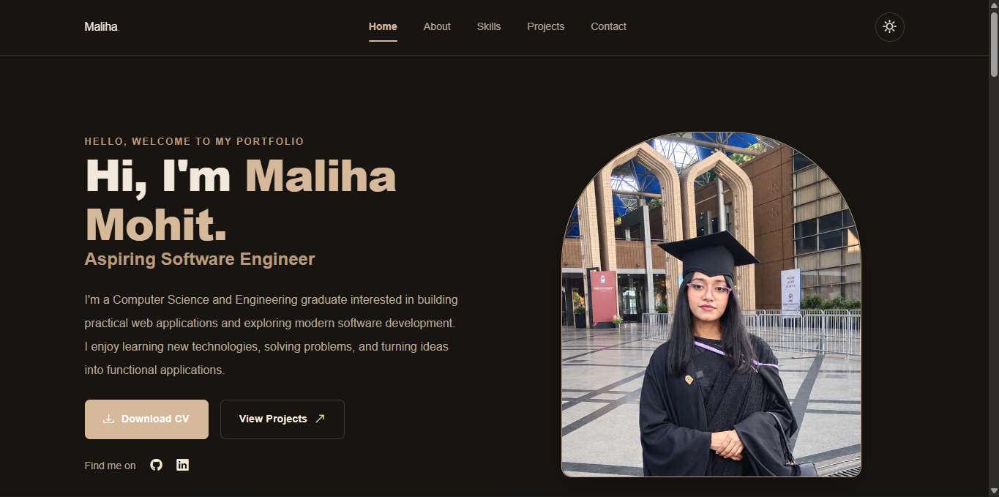
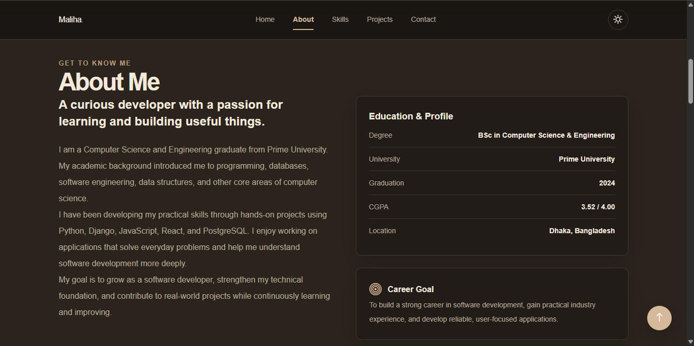
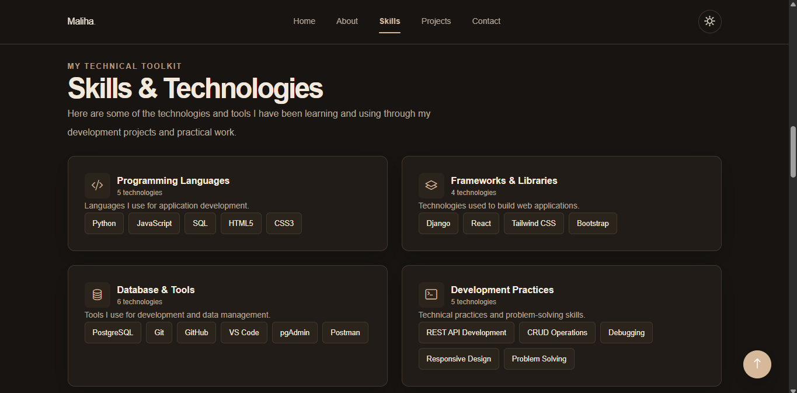
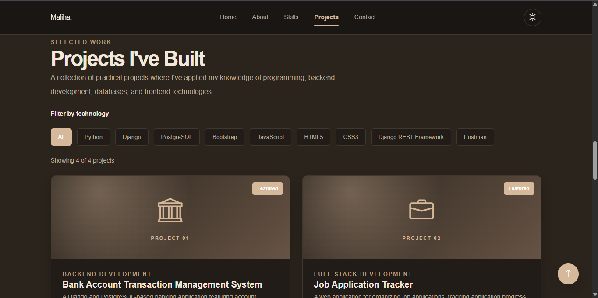
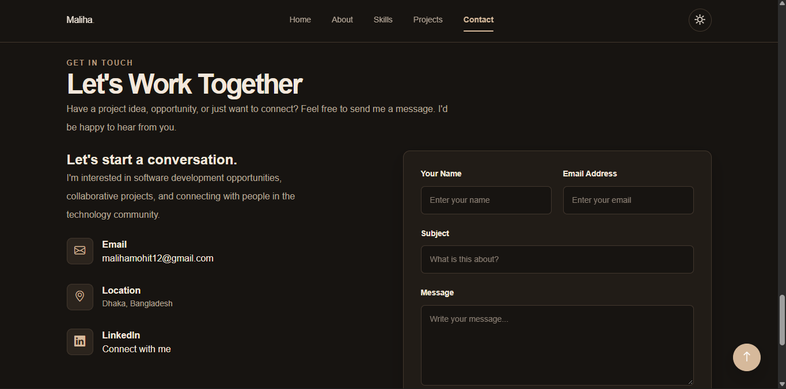

# Maliha Mohit | Personal Portfolio

A responsive personal portfolio website built with React.js, Tailwind CSS, and Bootstrap Icons. The website showcases my technical skills, development projects, educational background, and contact information.

## Live Website

[View Portfolio](https://personal-portfolio-ten-taupe-87.vercel.app/)

## Preview

### Home



### About



### Skills



### Projects



### Contact



## Features

- Responsive navigation for desktop and mobile.
- Personal introduction and profile section.
- Education and career goals.
- Categorized technical skills.
- Project gallery with technology-based filtering.
- Contact form with validation and email submission.
- Dark and light theme toggle.
- Active navigation based on the current section.
- Smooth scrolling and scroll-to-top functionality.
- Downloadable CV.
- Responsive footer with social links.

## Tech Stack

**Frontend**
- React.js
- JavaScript
- Tailwind CSS
- Bootstrap Icons
- HTML5
- CSS3

**Development Tools**
- Vite
- Git
- GitHub
- VS Code

**Services**
- Formspree for contact form submissions
- Vercel for deployment

## Project Structure

```text
src/
├── components/
│   ├── layout/
│   ├── sections/
│   └── ui/
├── data/
├── hooks/
├── App.jsx
├── index.css
└── main.jsx

public/
├── images/
├── favicon.svg
└── Maliha-Mohit-CV.pdf

index.html
package.json
README.md
```

## Getting Started

### 1. Clone the repository

```bash
git clone https://github.com/malihamohit1100/personal-portfolio
```

### 2. Navigate to the project directory

```bash
cd personal-portfolio
```

### 3. Install dependencies

```bash
npm install
```

### 4. Configure environment variables

Create a `.env` file in the project root.

```env
VITE_FORMSPREE_ENDPOINT=YOUR_FORMSPREE_ENDPOINT
```

### 5. Start the development server

```bash
npm run dev
```

Open the local URL provided by Vite.

## Production Build

To generate an optimized production build:

```bash
npm run build
```

To preview the production build locally:

```bash
npm run preview
```

## Contact

**Maliha Mohit**

- GitHub: https://github.com/malihamohit1100
- LinkedIn: https://www.linkedin.com/in/maliha-mohit-4375842b6/
- Email: malihamohit12@gmail.com

## License

This project is created for personal portfolio and educational purposes.
